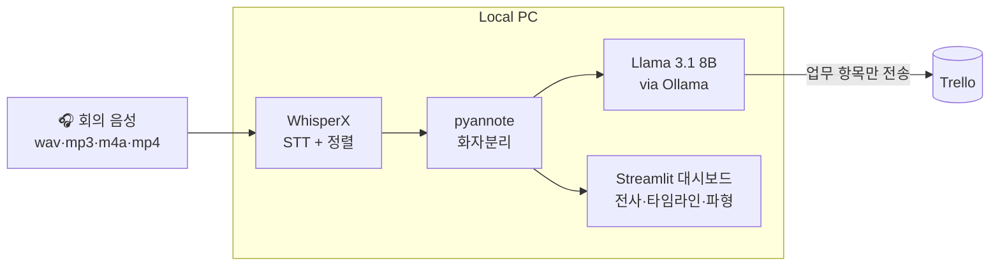

# 🎙️ Meeting AI — 회의 음성 분석 · Trello 업무 자동화

> 회의 녹음 파일 하나로 **음성인식 → 화자분리 → 업무(Action Item) 추출 → Trello 카드 등록**까지.
> 음성과 전체 전사문은 내 PC 밖으로 나가지 않고, **정리된 업무 항목만** Trello로 전송됩니다.

졸업논문 「WhisperX 및 Ollama 기반 회의 음성 분석 및 Trello 업무 자동화 시스템」의 구현 저장소입니다.

- 📺 **시연 영상 · 인터랙티브 데모**: https://kitbomin.github.io/projects/meeting-ai/
- 👤 김보민 · 동서대학교 소프트웨어학과 (인공지능공학과 복수전공)

---

## 무엇을 하나요

| 단계 | 사용 기술 | 결과 |
|---|---|---|
| 1. 음성인식(STT) | WhisperX (`medium`) + 강제 정렬 | 단어 단위 타임스탬프가 붙은 한국어 전사문 |
| 2. 화자분리 | pyannote.audio (WhisperX `DiarizationPipeline`) | 발화마다 `SPEAKER_00`, `SPEAKER_01` … |
| 3. 업무 추출 | Ollama · Llama 3.1 8B (temperature 0) | `title / description / assignee / due` JSON |
| 4. 업무 등록 | Trello REST API | 리스트에 카드 생성 (담당자·기한은 설명란) |
| 5. 시각화 | matplotlib · librosa · Streamlit | 화자 타임라인, 파형 + 화자 구간 |



### 실행 예시 (시연용 가상 회의, 43초 · 2명)

```text
[SPEAKER_00] 먼저 포스터 인쇄는 영희 씨가 내일까지 인쇄소에 파일을 보내주세요.
[SPEAKER_01] 네, 내일까지 인쇄소에 파일을 보내겠습니다.
[SPEAKER_00] 그리고 시연 영상은 철수 씨가 금요일까지 편집해서 공유해주세요.
...
```

| 업무 | 담당자 | 기한 |
|---|---|---|
| 포스터 인쇄 | 영희 | 내일 |
| 시연 영상 편집 | 철수 | 금요일 |
| 노트북 준비 | 철수 | 수요일 |
| 발표 대본 정리 | 영희 | 목요일 |

처리 시간 (RTX 4060 Laptop): 모델 로딩 16.1초 · STT+화자분리 33.4초 · 업무 추출 36.4초

## 평가 (논문 IV장)

한국어 대화 음성 3개(총 74.1초)에 대해 정답 전사문을 표준 표기로 정규화한 뒤 측정했습니다.

| 지표 | 결과 |
|---|---|
| WER (어절) | **25.45%** (정규화 전 31.43%) |
| CER (음절) | **12.88%** |
| sWER (띄어쓰기 정규화) | **21.82%** |

- 남은 오류는 주로 **인명·유사 발음 어휘의 치환**이며, 인명 오인식은 담당자 필드까지 그대로 전파됩니다.
- 짧은 맞장구가 많은 대화에서는 **화자분리가 한 명으로 합쳐지는** 한계가 있습니다.
- 업무 추출 정확도는 별도로 정량 평가하지 않았습니다.

## 프로젝트 구조

```
app/
├── main.py                     # FastAPI 앱
├── routes/meeting_route.py     # POST /meeting/upload
└── services/
    ├── stt_service.py          # WhisperX STT + 정렬 + 화자분리 (모델 캐시)
    ├── action_item_service.py  # Ollama 프롬프트, JSON 응답 파싱
    ├── trello_service.py       # Trello 카드 생성
    ├── wer_evaluation.py       # jiwer 기반 WER 계산
    ├── timeline_visualizer.py  # 화자 타임라인 이미지
    └── waveform_visualizer.py  # 파형 + 화자 구간 이미지
dashboard.py                    # Streamlit UI
run_pipeline.py                 # CLI: 음성 1개 → 결과 JSON
evaluate_stt_performance.py     # wer_references.json 기준 WER 리포트
```

## 실행 방법

### 1. 준비물
- Python 3.10, NVIDIA GPU 권장 (CPU도 동작하나 느림)
- [Ollama](https://ollama.com) 설치 후 `ollama pull llama3.1`
- Hugging Face 토큰 — [pyannote/speaker-diarization-3.1](https://huggingface.co/pyannote/speaker-diarization-3.1) 약관 동의 필요
- (선택) Trello API Key · Token · 리스트 ID

### 2. 설치
```bash
conda create -n meeting-ai python=3.10 -y
conda activate meeting-ai
pip install -r requirements.txt
```

### 3. 환경 변수 (`.env`)
```env
HUGGINGFACE_TOKEN=hf_xxx
TRELLO_KEY=xxx
TRELLO_TOKEN=xxx
TRELLO_LIST_ID=xxx
```

### 4. 실행
```bash
# 대시보드 (http://localhost:8501)
streamlit run dashboard.py

# REST API (http://localhost:8000/docs)
uvicorn app.main:app --port 8000
curl -F "file=@meeting.m4a" "http://localhost:8000/meeting/upload?send_to_trello=false"

# CLI — Trello 전송 없이 결과 JSON만
python run_pipeline.py meeting.m4a -o outputs/result.json

# STT 성능 평가 (wer_references.example.json 형식 참고)
python evaluate_stt_performance.py
```

## 개발 과정

이 저장소는 네 번째 버전입니다.

| 시기 | 저장소 | 구조 | 배운 점 |
|---|---|---|---|
| 2026.03 | [grad-proj](https://github.com/Kitbomin/grad-proj) | Spring Boot + FastAPI(Whisper) | 서버 간 연동, mp3 처리 |
| 2026.04 | [graduation-project-with-whisper](https://github.com/Kitbomin/graduation-project-with-whisper) | Spring Boot + JPA 업무 DB + FastAPI | 업무 도메인 모델링 |
| 2026.05 | [kanban-graduation-proj](https://github.com/Kitbomin/kanban-graduation-proj) | FastAPI 단독 · 화자분리 · Trello | 칸반을 직접 만들지 않고 Trello에 위임 |
| 2026.05~ | **meeting-ai-service-proj** | WhisperX + pyannote + Ollama, 로컬 처리 | 개인정보를 외부로 보내지 않는 구성 |

## 개인정보

- 업로드 음성·전사문·WER 정답 파일은 `.gitignore`로 저장소에서 제외됩니다.
- 시연에는 실제 인물이 아닌 **가상 대본**(영희·철수)만 사용했습니다.
